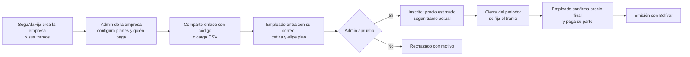

# Plan de trabajo: seguro de carro y moto como beneficio para empleados

> Creado el 2026-11-15. Línea de negocio B2B2C: una empresa ofrece a sus empleados el seguro de su carro o moto
> personal con Seguros Bolívar, a una tarifa que mejora con la cantidad de empleados inscritos. Las historias se
> registran como épica **E24** en el [backlog](04-backlog.md).

## Decisiones tomadas

| Tema | Decisión |
|---|---|
| Qué se asegura | Carros y motos personales de los empleados, con Seguros Bolívar |
| Quién paga | La empresa elige al configurar su programa: **empresa paga todo**, **empleado paga** (con opción de descuento por nómina) o **copago** (la empresa aporta un monto fijo por empleado) |
| Precio por volumen | **Tramos escalonados** por cantidad de empleados inscritos. El tramo se fija al **cerrar cada periodo de inscripción**; mientras está abierto, el empleado ve un precio estimado |
| Tipo de póliza | **Pólizas individuales con tarifa corporativa**. El modelo de datos deja lista la estructura de una póliza madre por si Bolívar exige póliza colectiva |
| Planes | La empresa habilita **2 o 3 planes** del catálogo de Bolívar y cada empleado elige uno |
| Vinculación | **Enlace con código** de la empresa y **validación por dominio de correo**; carga por **CSV** como opción |
| Retiro | Si el empleado sale de la empresa, **conserva su póliza hasta el vencimiento** y renueva a precio individual |
| Admin de la empresa | Aprueba vinculaciones y ve los planes elegidos. Dos roles: **administrador** y **solo lectura** |
| Panel de la empresa | Inscritos, tramo actual, ahorro total, pendientes de aprobar y reporte para nómina |
| Plataforma | Sección **`/empresas`** en el mismo sitio, con el **logo de cada empresa** en su portal. Sin subdominios por ahora |
| Anuncios | **Landing B2B** para captar empresas y **campañas dentro del portal** del empleado |
| Alcance antes del convenio | Flujo completo con **precios por volumen simulados**, para mostrarlo a Bolívar y a empresas piloto |

**Supuesto pendiente de confirmar (cómo cobramos a la empresa):** el ingreso es la comisión que paga Bolívar
por cada póliza; la empresa no paga una tarifa por la plataforma. Si se decide cobrarle, se agrega facturación
(fase 5).

## Qué se reutiliza

| Ya existe | Archivo | Uso en esta línea |
|---|---|---|
| Cotización de flotas con solicitud de propuesta | `src/app/flotas`, `src/components/fleet` | Punto de entrada actual para empresas. La landing nueva lo reemplaza o lo enlaza |
| Motor de descuentos con reglas por aseguradora y plan | `src/domain/discounts.ts` | La tarifa corporativa es una regla nueva de origen "empresa", con el porcentaje del tramo |
| Cuestionario, recomendación y checkout | `src/components/quote`, `src/recommendation`, `src/components/checkout` | El empleado cotiza igual que hoy, pero solo con los planes habilitados |
| Emisión asíncrona con reintentos | `src/server/orders.ts` | Cada empleado se emite como hoy |
| Ingreso con código por correo | `src/server/auth.ts` | Ingreso del empleado y del admin de la empresa |
| Roles del admin de la plataforma | `src/server/admin.ts` | Modelo para los roles del admin de la empresa |
| Campañas con audiencia | `src/server/db.ts` (`Campaign`) | Se amplía la audiencia a "empleados de la empresa X" |
| Analítica propia | `src/lib/analytics.ts` | Embudo por empresa: invitados → inscritos → aprobados → emitidos |

## Cómo funciona

**Tramos de ejemplo (simulados hasta negociar con Bolívar):**

| Empleados inscritos al cierre | Descuento sobre la tarifa |
|---|---|
| 10 a 24 | 5 % |
| 25 a 49 | 8 % |
| 50 a 99 | 11 % |
| 100 o más | 14 % |

El tope general de descuentos (`maxTotalPct`, hoy 15 %) sigue aplicando sobre la suma de reglas.

## Modelo de datos (nuevo)

| Entidad | Campos principales |
|---|---|
| `Company` | nombre, `slug`, logo, dominios de correo, código de vinculación, modelo de pago (`empresa` / `empleado` / `copago` + aporte), planes habilitados, tramos, estado |
| `CompanyAdmin` | usuario, empresa, rol (`admin` / `lectura`) |
| `Membership` | usuario, empresa, estado (`pendiente` / `aprobado` / `rechazado` / `retirado`), cómo llegó (código, dominio, CSV), quién aprobó y cuándo |
| `EnrollmentPeriod` | empresa, apertura, cierre, tramo con el que cerró |
| `CompanyOrder` (extensión de `Order`) | empresa, parte que paga la empresa, parte que paga el empleado, autorización de descuento por nómina |
| `MasterPolicy` (opcional) | Póliza madre de la empresa, solo si Bolívar exige colectiva; cada póliza individual queda como certificado |

## Fases

### Fase 0: decisiones y convenio (en paralelo con el plan de Bolívar)

| # | Tarea | Responsable | Entregable |
|---|---|---|---|
| 0.1 | Preguntar a Bolívar: ¿tarifa corporativa por tramos? ¿Póliza colectiva o individuales? ¿Quién recauda cuando paga la empresa? | Negocio | Respuestas en el cuestionario de Bolívar |
| 0.2 | Confirmar el supuesto de cobro (solo comisión, sin tarifa a la empresa) | Negocio | Decisión escrita |
| 0.3 | Revisión legal: tratamiento de datos de empleados cargados por la empresa (Ley 1581) y autorización del empleado para el descuento por nómina | Legal | Textos de autorización |
| 0.4 | Identificar 1 o 2 empresas piloto | Negocio | Empresas interesadas |

### Fase 1: base y landing (código, con datos simulados)

| # | Tarea | Entregable |
|---|---|---|
| 1.1 | ✅ Modelo de datos (`Company`, `CompanyAdmin`, `Membership`, `EnrollmentPeriod`) y tramos simulados | Tipos, almacenamiento y pruebas |
| 1.2 | ✅ En el admin de la plataforma: crear empresas, subir logo, definir tramos, dominios y código | Sección "Empresas" en `/admin` |
| 1.3 | ✅ Landing `/empresas` para captar empresas: beneficio, ejemplo de ahorro por tramo, formulario "Quiero el beneficio para mi empresa" que llega a la bandeja de oportunidades | Página pública con SEO |
| 1.4 | ✅ Precio corporativo: regla de descuento de origen "empresa" según el tramo, calculada en el servidor | Pruebas de precios por tramo y del tope |

### Fase 2: portal del empleado

| # | Tarea | Entregable |
|---|---|---|
| 2.1 | ✅ Portal `/empresas/[slug]` con el logo de la empresa: qué incluye el beneficio, quién paga, cierre del periodo | Página del programa |
| 2.2 | ✅ Vinculación: por enlace con código, por dominio de correo o por invitación del CSV. Ingreso con código por correo | Solicitud de vinculación |
| 2.3 | ✅ Cotizar con los planes habilitados y precio estimado del tramo actual ("hoy: 8 %; si llegan a 50 inscritos, 11 %") | Resultados de cotización para empleados |
| 2.4 | ✅ Estado del empleado: pendiente, aprobado, rechazado (con motivo), precio final, póliza | Sección en "Mi cuenta" |

**Cómo quedó la fase 2:** durante la inscripción el empleado **elige** su plan con el precio estimado del tramo
actual; no paga todavía. La elección queda guardada en su vinculación y se confirma y paga al cierre (fase 4). La
cotización como empleado usa rutas propias (`/api/empresas/[slug]/cotizacion` y `/eleccion`) que verifican la sesión y
la vinculación; la cotización individual no cambia. El portal (`/empresas/[slug]`) es solo del servidor, así que no
está en la demo estática.

### Fase 3: admin de la empresa

| # | Tarea | Entregable |
|---|---|---|
| 3.1 | ✅ Panel `/empresas/[slug]/admin` con roles administrador y solo lectura | Acceso protegido |
| 3.2 | ✅ Bandeja de vinculaciones: aprobar o rechazar, una por una o en lote | Aprobaciones con bitácora |
| 3.3 | ✅ Configuración: planes habilitados, quién paga, aporte del copago, periodos de inscripción | Formulario de programa |
| 3.4 | ✅ Invitaciones por CSV (nombre y correo) con validación y aviso de duplicados | Carga masiva |
| 3.5 | ✅ Resumen: inscritos, tramo actual y siguiente, ahorro total, pendientes; reporte para nómina en CSV | Panel y exportación |

El admin de la empresa ve nombre, correo, plan elegido, estado y valor. **No ve** la fecha de nacimiento, la placa
ni las respuestas del cuestionario del empleado.

**Cómo quedó la fase 3:** los administradores de cada empresa los asigna SeguAlaFija en `/admin` (correo y rol). Las
personas invitadas por lista o CSV quedan en estado "invitado" y **no cuentan para el tramo** hasta que entran con ese
correo; al entrar quedan aprobadas, porque la empresa ya las invitó. La empresa configura quién paga, el aporte del
copago, el cierre de la inscripción y los planes; los tramos y dominios siguen en manos de SeguAlaFija.

### Fase 4: cierre del periodo, cobro y emisión

| # | Tarea | Entregable |
|---|---|---|
| 4.1 | Cierre del periodo: fijar el tramo, recalcular precios y avisar a cada empleado su precio final | Cierre automático con cron |
| 4.2 | Cobro según el modelo: el empleado paga con Wompi (o autoriza el descuento por nómina); la parte de la empresa queda en un reporte de cobro mensual | Órdenes con dos partes |
| 4.3 | Emisión por empleado con el flujo actual (reintentos, demora, rechazo) | Pólizas emitidas |
| 4.4 | Retiro de empleados: el admin lo marca retirado, la póliza sigue hasta el vencimiento y renueva a precio individual | Flujo de retiro |

### Fase 5: anuncios y comunicaciones

| # | Tarea | Entregable |
|---|---|---|
| 5.1 | Campañas dentro del portal con audiencia por empresa | Campañas segmentadas |
| 5.2 | Correos: invitación, aprobación, recordatorio antes del cierre ("faltan 5 inscritos para el siguiente tramo") y precio final | Plantillas |
| 5.3 | Embudo por empresa en el admin de la plataforma: invitados, inscritos, aprobados, emitidos | Métricas |
| 5.4 | (Si se decide cobrar a la empresa) facturación | Depende de 0.2 |

### Fase 6: piloto

Con 1 o 2 empresas, cuando estén el convenio con Bolívar, Supabase y Wompi en producción. Criterio de éxito
propuesto: al menos 30 % de los empleados invitados se inscriben en el primer periodo.

## Dependencias

| Dependencia | Bloquea | Estado |
|---|---|---|
| Tarifa corporativa con Bolívar | Precios reales (los tramos son simulados) | Pendiente (preguntar en 0.1) |
| Supabase (HU-09.6) | Uso real: hoy los datos viven en memoria y se pierden al reiniciar | Pendiente |
| Wompi en producción (HU-07.2) | Cobro real a empleados | Pendiente |
| Resend (HU-10.5) | Correos de invitación y aprobación reales | Pendiente |
| Revisión legal (0.3) | CSV de empleados y descuento por nómina | Pendiente |

## Riesgos

- **Precio que cambia:** si el empleado ve un precio estimado y el tramo final es peor, se frustra. Mitigación:
  mostrar siempre el tramo "asegurado" (el actual) y el posible, y pedir confirmación del precio final antes de cobrar.
- **Privacidad:** la empresa no debe ver datos que no necesita. Por eso el panel solo muestra lo mínimo.
- **Carga operativa del admin:** si hay muchas aprobaciones manuales, se vuelve lento. Mitigación: aprobación
  automática opcional para correos del dominio de la empresa.
